<div align="center">


# Duly

### Every invoice, duly done.

**A smart procure-to-pay assistant.** Duly reads supplier invoices, checks them against purchase orders and goods receipts,<br/>
and **approves, flags or blocks** each one with a clear reason. **Rules decide. AI only reads and explains.**

<br/>

[](https://www.duly.website)
[](https://github.com/shivanshjindal28/Duly/commits/main)
[](https://github.com/shivanshjindal28/Duly/commits/main)


<br/>

[**Live demo**](https://www.duly.website) ·
[**Quick start**](#-quick-start) ·
[**Architecture**](docs/ARCHITECTURE.md) ·
[**Decision engine**](docs/DECISION_ENGINE.md) ·
[**Security**](docs/CONTROLS.md)

<br/>

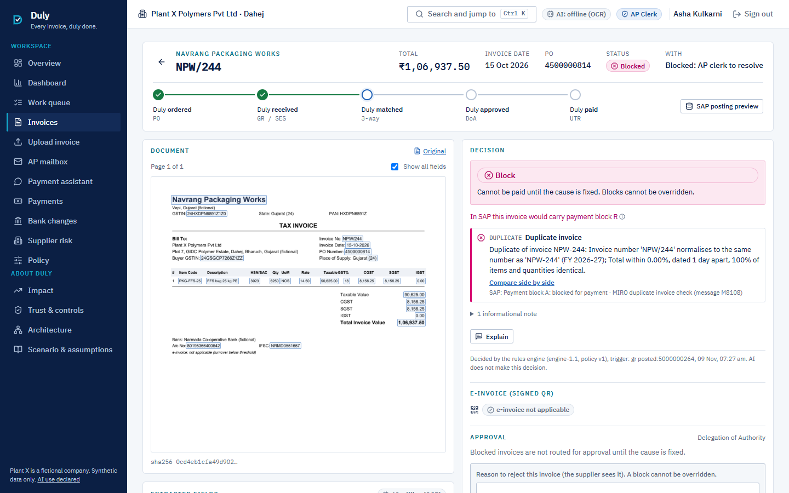

<sub>The hero screen: original document with every extracted field boxed · the engine's decision with its reason code and SAP equivalent · the five-stop Duly lifecycle.</sub>

</div>

<br/>

> [!IMPORTANT]
> The demo runs on **Plant X Polymers Pvt Ltd, a fictional polymer plant**. Every supplier, GSTIN, PAN, bank account and
> person in this repository is synthetic.

> [!TIP]
> **Try it in 30 seconds:** open **[www.duly.website](https://www.duly.website)** and click any demo persona on the login page: no password needed.
> The free backend sleeps when idle, so the first load can take up to a minute; the page shows *Connecting…* and the personas appear on their own.

<details>
<summary><b>Table of contents</b></summary>

- [Why Duly](#-why-duly)
- [How it works](#-how-it-works)
- [Features](#-features)
- [What makes Duly different](#-what-makes-duly-different)
- [Screenshots](#-screenshots)
- [The decision engine](#-the-decision-engine)
- [Architecture](#-architecture)
- [Responsible AI, security and data](#-responsible-ai-security-and-data)
- [Scenarios to try](#-scenarios-to-try)
- [Quick start](#-quick-start)
- [Demo accounts](#-demo-accounts)
- [Testing and quality](#-testing-and-quality)
- [Deployment](#-deployment)
- [Project structure](#-project-structure)
- [Tech stack](#-tech-stack)
- [Documentation](#-documentation)
- [Troubleshooting](#-troubleshooting)

</details>

---

## 💡 Why Duly

Plant X's finance team processes large volumes of supplier invoices. Mismatches with purchase orders or goods receipts,
duplicates and missing approvals cause **late payments, delays and audit risk**: MSME suppliers paid after the
statutory 45 days, the same invoice paid twice, fraudsters changing bank details, and clerks spending their day
reconciling paper.

| The pain | What Duly does |
|---|---|
| Clerks key in every invoice by hand | Reads PDFs, scans and phone photos (text layer + local OCR), **every field with a confidence score and its box on the page** |
| Mismatches found after payment | **Three-way match** (PO · goods receipt / service entry · invoice) with SAP-style tolerances **before** anything is paid |
| "Why was this held?" | Every decision carries **reason codes, evidence, the policy version and the SAP equivalent**, plus a plain-words *Explain* |
| Duplicates and fraud | Five duplicate signals, **bank-detail change block**, signed e-invoice QR verification, prompt-injection shield |
| Late MSME payments | **45-day guardian** and a **smart payment run** that pays MSMEs first and takes early-payment discounts only when they beat the cost of funds |
| Audit pain | **Hash-chained, tamper-evident audit trail** and a one-click **controls report** tested against live data |

---

## ⚙️ How it works

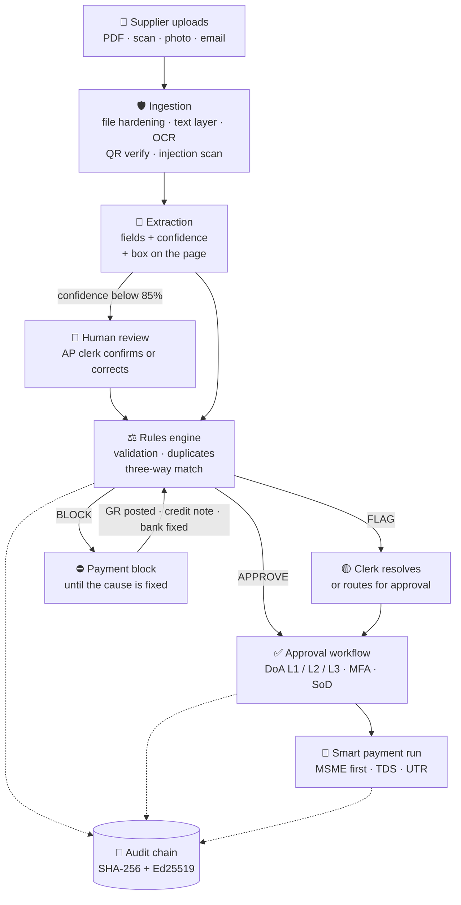

Each invoice moves through the five stops that give Duly its name:

> **Duly ordered** (PO) → **Duly received** (GR / SES) → **Duly matched** (3-way) → **Duly approved** (DoA) → **Duly paid** (UTR)

A blocked invoice is **re-checked automatically** when the cause goes away: stores posts the goods receipt, the supplier
issues a credit note, or the bank change is verified. Nobody has to remember to come back to it.

---

## ✅ Features

| Feature | What you get |
|---|---|
| **Roles** | Six roles (supplier, AP clerk, approvers L1–L3, stores, auditor, admin), each enforced on the server |
| **Reading invoices** | PDFs, scans and phone photos; every field boxed on the document with a confidence score, low confidence goes to a person |
| **Matching and decisions** | Invoice · PO · goods receipt or service entry, approve / flag / block with the reason and its SAP equivalent |
| **Approvals** | Delegation-of-authority bands, MFA above ₹10 lakh, segregation of duties, delegation, a tamper-evident audit chain |
| **Exceptions** | Dashboard by type, supplier and age; a keyboard-first work queue with saved views and CSV export |
| **Duplicates** | Five signals (normalised number, file hash, perceptual hash, IRN, amount + date + lines) with a side-by-side compare |
| **Supplier portal** | Status of every invoice, what to fix, the expected payment date, and a "where is my payment?" assistant in English and हिन्दी |
| **Audit** | A controls report that tests 10 controls against the live data, downloadable as a PDF |
| **Insight** | Impact, architecture and trust pages, all computed live |

---

## 🚀 What makes Duly different

<table>
<tr>
<td width="50%" valign="top">

**Trust the signed QR, not the pixels**<br/>
Verifies the GST e-invoice QR signature (RS256) and compares the signed values with the printed ones. An edited total is caught even when the PDF looks perfect.

**AI prompt-injection shield**<br/>
Finds hidden white text, tiny fonts and off-page text aimed at the AI, quarantines it and flags the invoice.

**Bank-detail fraud block**<br/>
An invoice printing bank details that differ from the vendor master is blocked. Changes need a call-back, a 72-hour cooling period and a second approver.

**MSME 45-day guardian**<br/>
Tracks the statutory due date (MSMED Act s.15) for every Udyam-registered supplier, with countdowns, interest exposure and the tax deduction at risk.

</td>
<td width="50%" valign="top">

**Smart payment run**<br/>
Orders payments by statutory due date, takes early-payment discounts only when they beat the cost of funds, computes TDS and shows the cash impact.

**SAP-ready by design**<br/>
Reason codes map to SAP payment blocks and transactions (MIRO, MIGO, ME23N). A **SAP posting preview** shows the exact S/4HANA OData payload.

**Explain everything**<br/>
Every reason has its rule text, evidence and SAP equivalent; *Explain* writes the decision in plain words from the reason codes only.

**Supplier risk card**<br/>
Live per-supplier view: dispute rate, duplicate attempts, bank changes, on-time payment, e-invoice compliance.

</td>
</tr>
</table>

<details>
<summary><b>And more: currencies and units, self-billing, credit notes, email-in, policy editor…</b></summary>

<br/>

| Feature | What it does |
|---|---|
| 💱 **Currencies** | Import invoices (e.g. EUR from a German supplier) are matched in the PO currency and converted to INR at a dated, editable policy rate for approval limits, MFA, dashboards and payment runs. GST rules are skipped for imports. |
| 📦 **Units of measure** | Standard conversions (kg / quintal / MT, L / KL, mm / m, dozen…) plus item pack sizes from the item master: *12 BOX* is matched as *120 NOS*. Stores can receive in boxes too. |
| 🚚 **Evaluated receipt settlement** | Freight POs are self-billed from the receipt: no supplier invoice, same rules engine. |
| 🧾 **Credit notes** | A supplier credit note releases an over-billing block and re-runs the match. |
| 📧 **Email-in** | Simulated AP mailbox with real MIME parsing and lookalike-sender detection. |
| 🎛️ **Policy editor** | Tolerances, approval bands, MFA threshold, MSME and TDS rates, FX rates: versioned data, not code. Every decision records the policy version it used. |
| 🗂️ **Data retention** | Originals purged on schedule; the SHA-256 is kept so a resubmitted copy is still caught as a duplicate. |
| ⌨️ **Power-user UX** | `Ctrl K` command palette, J / K / Enter / R / F queue shortcuts, saved views, CSV export. |
| 📱 **Phone layout** | Drawer navigation, stacked receiving cards, full-screen chat; checked by an automated 375 px test. |
| 🔌 **AI kill switch** | Live · cached · offline. The whole product works offline (local OCR + rules). |

</details>

---

## 🖼️ Screenshots

<table>
<tr>
<td width="50%">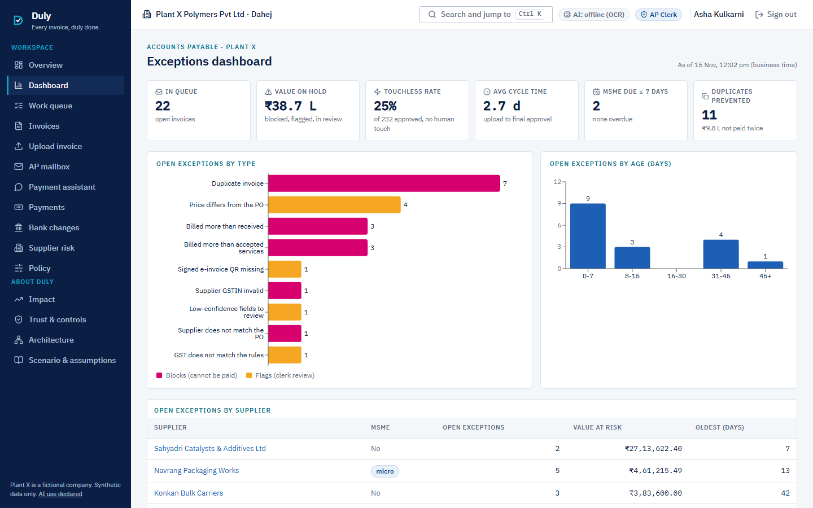<br/><sub><b>Exceptions dashboard</b>: KPIs, open exceptions by type, age and supplier.</sub></td>
<td width="50%">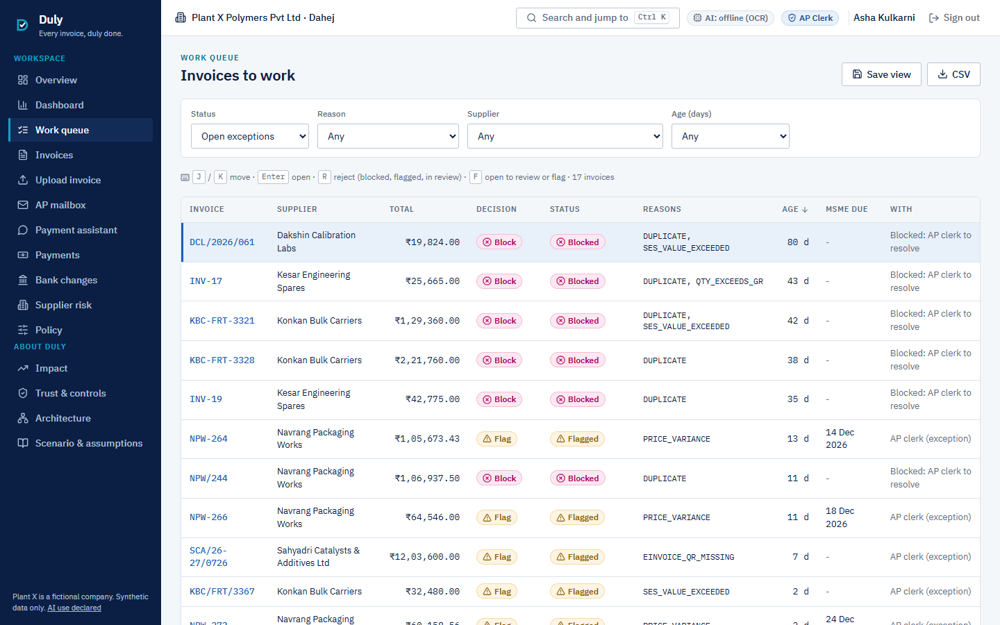<br/><sub><b>Work queue</b>: filters, saved views, keyboard shortcuts.</sub></td>
</tr>
<tr>
<td>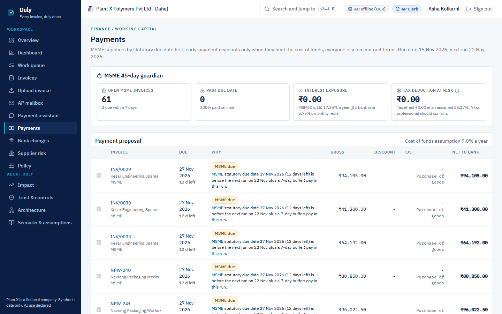<br/><sub><b>Payments</b>: MSME 45-day guardian and the smart payment run.</sub></td>
<td>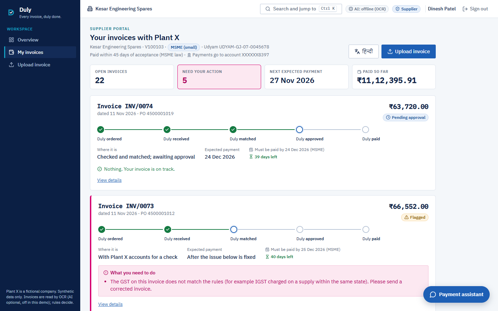<br/><sub><b>Supplier portal</b>: where each invoice is, what to fix, when it will be paid.</sub></td>
</tr>
<tr>
<td>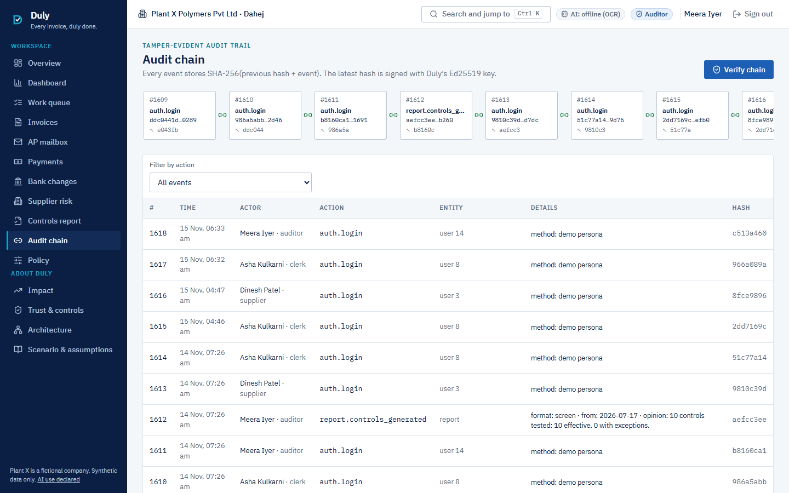<br/><sub><b>Audit chain</b>: hash-chained events with one-click verification.</sub></td>
<td>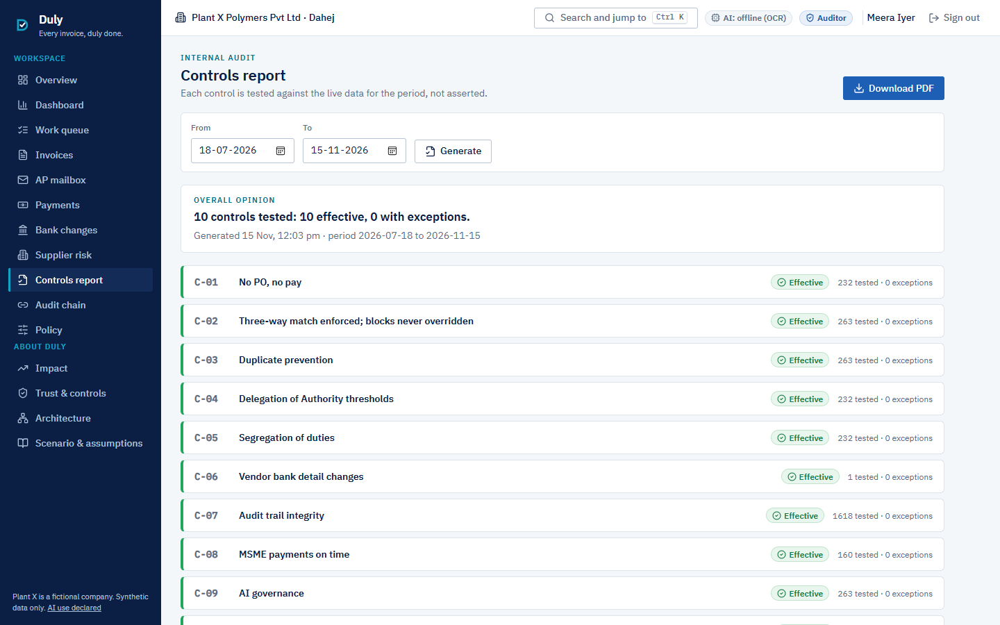<br/><sub><b>Controls report</b>: 10 controls tested against live data.</sub></td>
</tr>
<tr>
<td>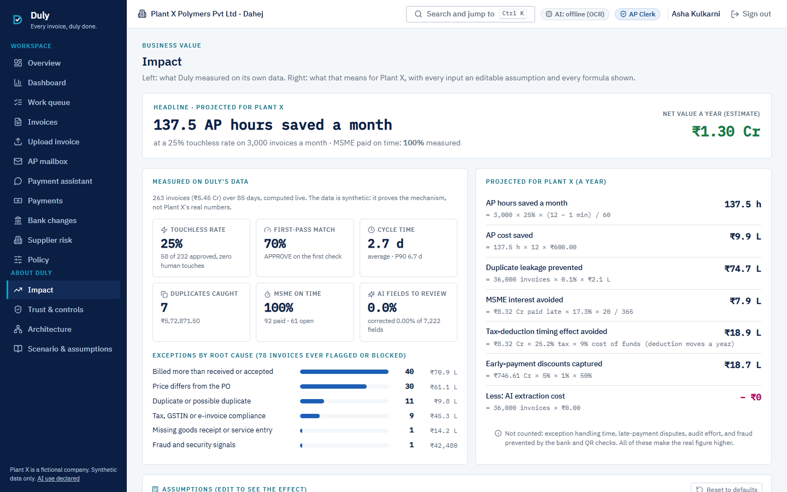<br/><sub><b>Impact</b>: measured on Duly's own data, projected with editable assumptions.</sub></td>
<td>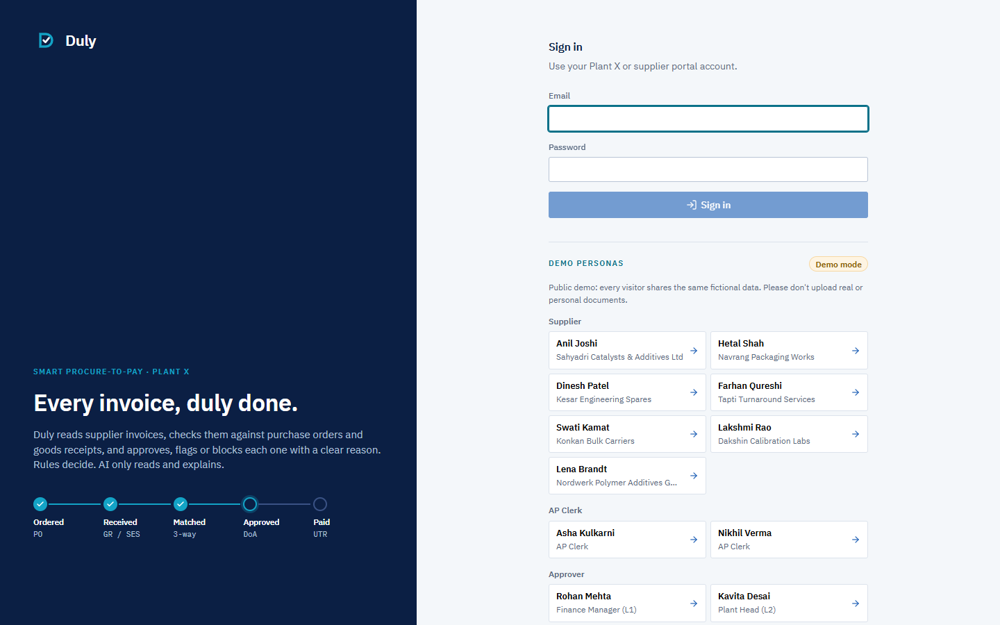<br/><sub><b>Login</b>: one-click demo personas for every role.</sub></td>
</tr>
</table>

<details>
<summary><b>📱 On a phone</b></summary>

<br/>

<p align="center">
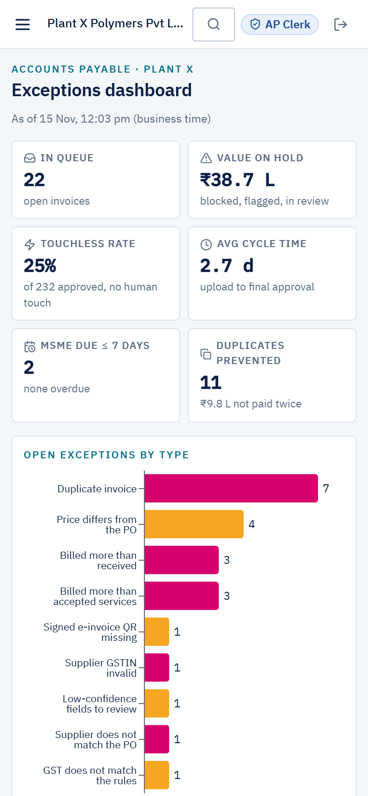
&nbsp;&nbsp;
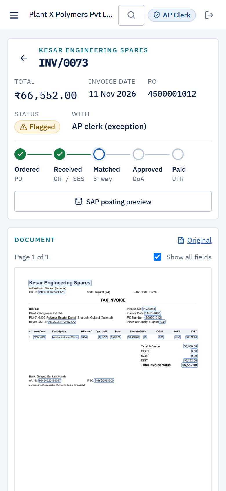
</p>

</details>

---

## ⚖️ The decision engine

The engine (`backend/app/engine/`) is **pure**: no I/O, no database, no AI. It takes the extracted invoice, the PO
view, the supplier and the active policy, and returns a decision with reasons. **A test fails the build if the engine
ever imports the AI package.**

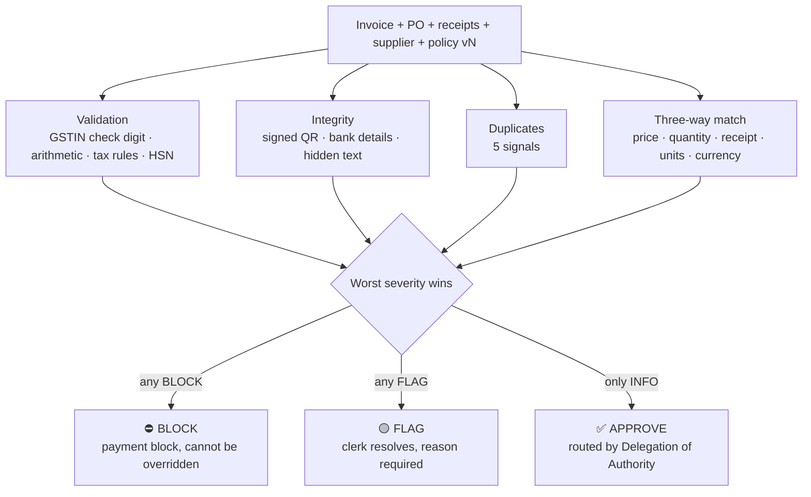

**38 reason codes** across header and supplier checks, line matching, tax and arithmetic, duplicates, document integrity and workflow. A few examples:

| Code | Severity | Fires when | SAP equivalent |
|---|:-:|---|---|
| `PRICE_VARIANCE` | ℹ️ / 🟡 / ⛔ | Unit price above the PO: flag above 1 % or ₹500 on the line, block above 5 % | Block R · MIRO (key PP) |
| `QTY_EXCEEDS_GR` | ℹ️ / 🟡 / ⛔ | Billed more than received, beyond the quantity tolerance | Block R · MIGO / MIRO (key DQ) |
| `MISSING_GR` | ⛔ | Nothing received yet; released automatically when stores posts the receipt | Block R · MIGO 101 |
| `DUPLICATE` | ⛔ | Same normalised number (`INV/0042` = `INV-42`), same IRN or same file as an earlier invoice | Block A · MIRO duplicate check (M8108) |
| `BANK_MISMATCH` | ⛔ | Bank account or IFSC differs from the vendor master (possible BEC fraud) | Block A · XK03 |
| `QR_MISMATCH` | ⛔ | Signed e-invoice values differ from the printed GSTINs, number, date or total | Block A · J1IG / IRP |
| `GSTIN_INVALID` | ⛔ | Supplier GSTIN fails the check digit | Block A · XK03 |
| `INJECTION_ATTEMPT` | 🟡 | Hidden instructions aimed at the AI found in the document | Duly control |
| `CURRENCY_CONVERTED` | 🟡 | Invoice currency differs from the PO; converted at the policy FX rate | Block R · MIRO / OB08 |
| `UOM_CONVERTED` | ℹ️ | Billed unit converted to the PO unit (e.g. 1 BOX = 10 NOS) | MIRO order unit / MM03 |

<details>
<summary><b>Default policy (editable on the Policy page, versioned)</b></summary>

<br/>

| Setting | Default |
|---|---|
| Price variance | flag above 1 % or ₹500 per line · block above 5 % |
| Quantity over-billing | 0 % (bulk MT items 0.5 %) · block above 5 % |
| Touchless approval | up to ₹50,000 with no exceptions |
| Delegation of authority | L1 Finance Manager up to ₹10 lakh · L2 Plant Head up to ₹1 crore · L3 CFO above |
| MFA (TOTP) | above ₹10 lakh |
| Extraction confidence | below 85 % needs a human |
| Bank-change cooling period | 72 hours |
| MSME | 45-day cap · 15 days without a written agreement · interest 3 × RBI bank rate |
| FX (INR per unit) | EUR 104.21 · USD 94.18 · GBP 124.63 · … (as of 2026-11-13) |

</details>

Full catalogue with every rule, tolerance and SAP equivalent: **[docs/DECISION_ENGINE.md](docs/DECISION_ENGINE.md)**.

---

## 🏗️ Architecture

Duly is a **side-car to the ERP**: a React single-page app, a FastAPI backend with the deterministic rules engine at
its centre, and SQLite (Postgres-ready via `DATABASE_URL`).

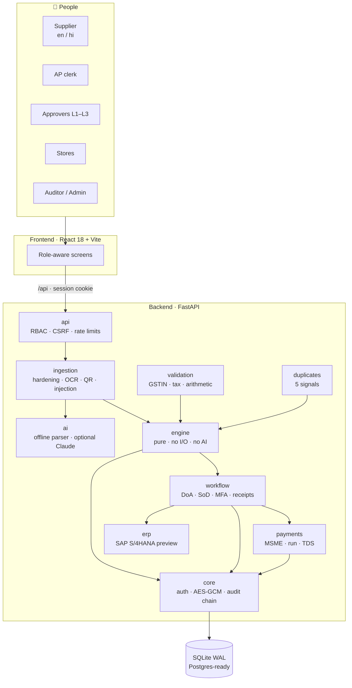

<details>
<summary><b>Sequence: what happens on upload</b></summary>

<br/>

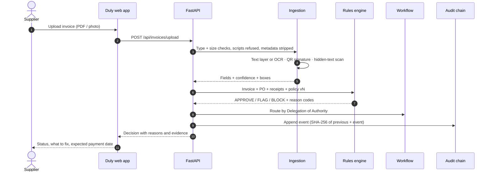

</details>

More: **[docs/ARCHITECTURE.md](docs/ARCHITECTURE.md)** (also rendered in the app at `/architecture`).

---

## 🔐 Responsible AI, security and data

<table>
<tr><th>Area</th><th>Control</th></tr>
<tr><td>🤖 <b>AI never decides</b></td><td>The deterministic engine makes every approve / flag / block decision. AI only extracts values and answers questions. The engine package cannot import the AI package (enforced by a test). The <i>Trust &amp; controls</i> page shows decisions made by AI: <b>0</b>.</td></tr>
<tr><td>👤 <b>Human in the loop</b></td><td>Fields below 85 % confidence, or where AI and the PDF text layer disagree, go to a person. Every correction is logged with the old and new value.</td></tr>
<tr><td>🔌 <b>Offline by default</b></td><td>Local OCR (RapidOCR / ONNX) and rules; no data leaves the machine. AI kill switch on the admin page.</td></tr>
<tr><td>🛡️ <b>Prompt-injection shield</b></td><td>Hidden or off-page text is quarantined before any model sees the document.</td></tr>
<tr><td>🔑 <b>Access</b></td><td>Argon2 passwords, HTTP-only session cookie, CSRF tokens, rate limits, lockout after 5 failures, TOTP MFA for high-value approvals, segregation of duties (no approving your own work).</td></tr>
<tr><td>🔒 <b>Data</b></td><td>Bank accounts encrypted with AES-GCM; uploads stored under random names, fingerprinted (SHA-256) and stripped of metadata; supplier users only ever see their own records (server-side scoping).</td></tr>
<tr><td>🔗 <b>Tamper evidence</b></td><td>Every event is hash-chained (SHA-256) and the head is signed (Ed25519). The auditor can verify the chain and see exactly where it breaks.</td></tr>
<tr><td>🧪 <b>Fictional data</b></td><td>No real companies, GSTINs, PANs, bank accounts or people anywhere in the repository.</td></tr>
</table>

Details: **[docs/CONTROLS.md](docs/CONTROLS.md)**.

---

## 🎬 Scenarios to try

Ready-made invoice files live in [`demo/invoices/`](demo/invoices); [`demo/manifest.json`](demo/manifest.json) lists
who uploads each one and the expected result. They are all checked automatically by `scripts/demo_check.py`.

| ID | Scenario | Result | What Duly shows |
|:-:|---|:-:|---|
| S01 | Clean catalyst invoice with a signed e-invoice QR | ✅ APPROVE | QR verified, L1 + L2 approval with MFA |
| S02 | Additive billed 3.2 % above the PO price | 🟡 FLAG | `PRICE_VARIANCE` with the line and the amount |
| S03 | Bearings: 100 billed, 80 received | ⛔ BLOCK | Over-billing; released by a supplier credit note |
| S04 | Packaging invoice before the goods arrive | ⛔ BLOCK | Released automatically when stores posts the receipt |
| S05 | Same bearings invoice resubmitted as a phone photo | ⛔ BLOCK | Duplicate despite a reformatted number; side-by-side compare |
| S06 | Invoice with a different bank account | ⛔ BLOCK | Bank-detail fraud block and security alert |
| S07 | Hidden white text telling the AI to approve | 🟡 FLAG | Prompt-injection shield quarantines the text |
| S08 | PDF with an edited total, original signed QR | ⛔ BLOCK | Signed values vs printed values |
| S09A | Intra-state invoice charging IGST | 🟡 FLAG | GST rule check |
| S09B | Invalid GSTIN check digit | ⛔ BLOCK | GSTIN validation |
| S10 | MSME supplier on day 41 of 45 | ✅ APPROVE | Paid first in the payment run, TDS computed |
| S11 | Turnaround maintenance services | ✅ APPROVE | Matched against the service entry sheet |
| S12 | Blurry, tilted phone photo | 👤 REVIEW | Low-confidence fields go to a human |
| S13 | Import invoice in EUR from a German supplier | ✅ APPROVE | €19,250 ≈ ₹20.1 lakh at the policy rate → L1 + L2 with MFA |
| S14 | Bearings billed in boxes against a PO in pieces | ✅ APPROVE | 12 BOX converted to 120 NOS |

<details>
<summary><b>A five-minute tour</b></summary>

<br/>

1. **Sanjay Patil** (admin) → *Demo controls* → **Reset demo data**.
2. **Supplier** uploads S04 → BLOCK (no goods receipt). **Imran** (stores) posts the receipt → Duly re-checks and releases it.
3. Upload S05, S06, S07, S08 → duplicate, bank fraud, prompt injection, edited total: each with its reason and SAP block.
4. **Rohan → Kavita** approve S01 with MFA. **Payments** → the run pays the MSME invoice first.
5. **Meera** (auditor) → *Audit chain* → **Verify**, then the tamper demo.

</details>

---

## ⚡ Quick start

> **Requirements:** Python **3.12** · Node.js **20.19+** or **22.12+** · Windows or macOS.
> No Docker, no system packages, no API key: just `pip` and `npm`.

```bash
git clone https://github.com/shivanshjindal28/Duly.git
cd Duly
python -m venv .venv
```

<details open>
<summary><b>Windows (PowerShell)</b></summary>

```powershell
.venv\Scripts\activate
pip install -r backend/requirements.txt
cd frontend; npm install; cd ..
Copy-Item .env.example .env
python scripts/seed.py --reset
python run.py
```

</details>

<details>
<summary><b>macOS / Linux</b></summary>

```bash
source .venv/bin/activate
pip install -r backend/requirements.txt
(cd frontend && npm install)
cp .env.example .env
python scripts/seed.py --reset     # ~25 s: master data + ~250 historical invoices
python run.py
```

</details>

| Service | URL |
|---|---|
| Web app | http://localhost:5173 |
| API | http://127.0.0.1:8000 |
| Interactive API docs (OpenAPI) | http://127.0.0.1:8000/api/docs |

<details>
<summary><b>Configuration (<code>.env</code>)</b></summary>

<br/>

| Variable | Default | Meaning |
|---|---|---|
| `DEMO_MODE` | `true` | One-click personas, reset and clock controls |
| `AI_MODE` | `offline` | `offline` (local OCR + rules), `cached`, `live` or `auto` |
| `ANTHROPIC_API_KEY` | *(empty)* | Optional; only used in `live` / `auto` |
| `DATABASE_URL` | SQLite file | Any SQLAlchemy URL, e.g. Postgres |
| `FRONTEND_ORIGIN` | `http://localhost:5173` | Allowed origin for the API |

See [`.env.example`](.env.example) for the full list. `.env` is git-ignored; never commit secrets.

</details>

<details>
<summary><b>Make targets (macOS)</b></summary>

```bash
make seed         # reset and seed the database
make run          # backend + frontend
make test         # backend tests
make demo-check   # the whole demo through the API
make e2e          # Playwright
make generate     # regenerate the demo invoice files
```

</details>

---

## 👥 Demo accounts

With `DEMO_MODE=true` the login page shows **one-click persona buttons**. For manual sign-in, every seeded user's
password is `Duly@2026` (synthetic demo data only).

| Role | People | Can |
|---|---|---|
| 🏭 Supplier | 7 suppliers, e.g. `invoices@kesar-spares.example`, `billing@nordwerk-additives.example` | Upload, track status, ask the assistant, see only their own invoices |
| 🧾 AP clerk | `asha.kulkarni@`, `nikhil.verma@plantx.example` | Review fields, resolve flags, run duplicate checks, propose payments |
| ✍️ Approver | `rohan.mehta@` (L1), `kavita.desai@` (L2), `vikram.rao@plantx.example` (L3) | Approve by Delegation of Authority, MFA above ₹10 lakh |
| 📦 Stores | `imran.shaikh@plantx.example` | Post goods receipts and service entries |
| 🔍 Auditor | `meera.iyer@plantx.example` | Audit chain, controls report (read-only) |
| ⚙️ Admin | `sanjay.patil@plantx.example` | Policy, demo controls, AI mode |

> [!NOTE]
> Five wrong passwords lock an account for 15 minutes. MFA secrets are regenerated on every reset: scan the QR on the approver's Overview page again.

---

## 🧪 Testing and quality

```bash
cd backend && python -m pytest                 # 226 tests: engine, duplicates, GSTIN, SoD, RBAC, audit chain, FX, units…
python scripts/demo_check.py                   # 30-step green/red run of every scenario through the API
cd frontend && npm run typecheck               # strict TypeScript
PW_CHANNEL=msedge npx playwright test          # 11 browser tests (or: npx playwright install chromium)
```

| Suite | What it proves |
|---|---|
| **pytest** (226) | Every engine rule and worked example, the five duplicate signals, GSTIN check digits, segregation of duties, supplier scoping, the hash chain, currencies and units, retention |
| **demo_check** (30 steps) | Every demo scenario gives its expected decision, status, totals and approval levels, plus the follow-ups (GR release, credit note, payment run, chatbot, tamper detection) |
| **Playwright** (11) | The demo path in a real browser, an **axe-core WCAG 2.1 AA scan of every screen with zero violations**, and a **375 px phone check** (drawer menu, no sideways scrolling, accessibility) |

Both `demo_check` and Playwright use their own temporary database and offline AI, so they never touch your data.

---

## ☁️ Deployment

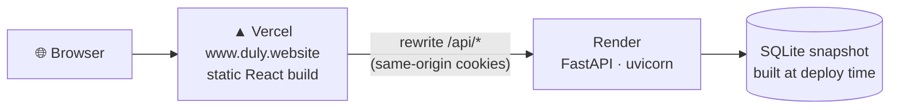

- **Frontend** on Vercel ([`frontend/vercel.json`](frontend/vercel.json)): Vite build, `/api/*` rewritten to the backend so cookies stay same-origin, SPA fallback.
- **Backend** on Render ([`render.yaml`](render.yaml)): the build seeds the database and pre-stages the background scenarios, then saves a snapshot; **Reset demo data** restores it in under a second. Demo mode on, AI offline.
- The free Render plan sleeps after ~15 idle minutes; the login page waits and retries until it is awake.

---

## 📁 Project structure

<details>
<summary><b>Show the tree</b></summary>

```text
Duly/
├── backend/
│   ├── app/
│   │   ├── api/           # FastAPI routers: auth, invoices, approvals, payments, stores, policy, audit, chat…
│   │   ├── engine/        # ⚖️ the pure rules engine: decide, match, units, policy, reason catalogue
│   │   ├── validation/    # GSTIN, arithmetic, tax and header rules
│   │   ├── duplicates/    # five duplicate signals
│   │   ├── ingestion/     # file hardening, text layer, OCR, QR verification, injection scan
│   │   ├── ai/            # offline parser, optional Claude extractor, merge, cache
│   │   ├── workflow/      # matching, approvals (DoA, SoD, MFA), receipts, credit notes, bank changes
│   │   ├── payments/      # MSME guardian, payment run, TDS
│   │   ├── erp/           # local adapter + SAP S/4HANA posting preview
│   │   ├── chat/          # supplier assistant: scoped tools and guardrails
│   │   ├── reports/       # controls report, impact model
│   │   ├── core/          # config, auth, crypto, audit hash chain, clock, policy defaults
│   │   ├── models/        # SQLAlchemy models
│   │   └── samples/       # synthetic invoice renderer and scenario definitions
│   └── tests/             # pytest suite
├── frontend/
│   ├── src/pages/         # 25 screens
│   ├── src/components/    # invoice detail panes, lifecycle rail, chat, command palette…
│   ├── src/i18n/          # English and Hindi
│   └── e2e/               # Playwright: demo path, accessibility, phone layout
├── demo/                  # ready-made scenario files + manifest
├── docs/                  # architecture, decision engine, controls, impact, assumptions
├── scripts/               # seed, demo_check, demo_prestage, generate_invoices, tamper_demo
├── render.yaml            # backend deployment
└── run.py                 # starts backend + frontend
```

</details>

---

## 🧰 Tech stack

| Layer | Technology |
|---|---|
| **Backend** | Python 3.12 · FastAPI · SQLAlchemy 2 · Pydantic v2 · SQLite (WAL) / Postgres-ready · uvicorn |
| **Documents** | pdfplumber · pypdfium2 · Pillow · OpenCV (headless) · RapidOCR (ONNX Runtime) · zxing-cpp · ImageHash · ReportLab |
| **Security** | argon2-cffi · PyJWT · pyotp (TOTP) · cryptography (AES-GCM, Ed25519, RS256) · slowapi |
| **AI (optional)** | Anthropic Python SDK, off by default (`AI_MODE=offline`) |
| **Frontend** | React 18 · TypeScript · Vite 8 · React Router 7 · TanStack Query · Recharts · lucide-react · i18next (en / hi) |
| **Testing** | pytest · Playwright · axe-core |
| **Hosting** | Vercel (frontend) · Render (backend) |

---

## 📚 Documentation

| Document | What's inside |
|---|---|
| [ARCHITECTURE.md](docs/ARCHITECTURE.md) | Components, invoice lifecycle, data model |
| [DECISION_ENGINE.md](docs/DECISION_ENGINE.md) | All 38 reason codes, tolerances, SAP equivalents, worked examples |
| [CONTROLS.md](docs/CONTROLS.md) | Responsible AI, security and data controls, and what is not built |
| [IMPACT.md](docs/IMPACT.md) | Impact model: measured metrics, formulas, assumptions |
| [ASSUMPTIONS.md](docs/ASSUMPTIONS.md) | Scenario, suppliers, policy values, tax tables, FX and pack sizes |

---

## 🛠️ Troubleshooting

<details>
<summary><b>Common problems and fixes</b></summary>

<br/>

| Problem | Fix |
|---|---|
| `pip install` fails | Use Python **3.12** (`py -3.12 -m venv .venv` on Windows); 3.13+ lacks wheels for some pinned packages |
| `Cannot find module './rolldown-binding…node'` | Node is older than 22.12 so npm skipped a native package: upgrade Node, or `npm install --no-save @rolldown/binding-win32-x64-msvc@<version>` in `frontend/` |
| `npm` not found on Windows | Reinstall Node.js and reopen the terminal |
| Port already in use | Free 8000 / 5173, or run `python run.py --backend` and `python run.py --frontend` separately |
| Locked out / messy data | `python scripts/seed.py --reset` (or *Demo controls → Reset demo data*) |
| MFA code refused after a reset | Approver secrets are regenerated: scan the QR on the approver's Overview page again |
| Live site shows *Connecting…* | The free backend is waking up; wait up to a minute |

</details>

---

<div align="center">

**Duly** · Every invoice, duly done.

<sub>Plant X is a fictional company. All data is synthetic. Rules decide; AI only reads and explains.</sub>

<br/>

<a href="#duly">⬆ Back to top</a>

</div>
