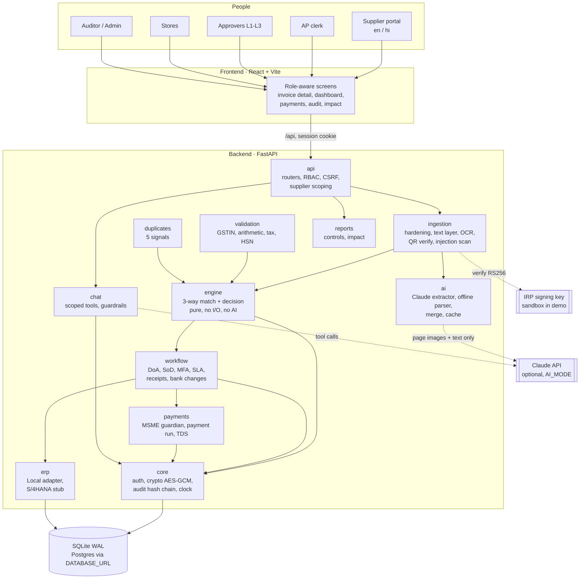
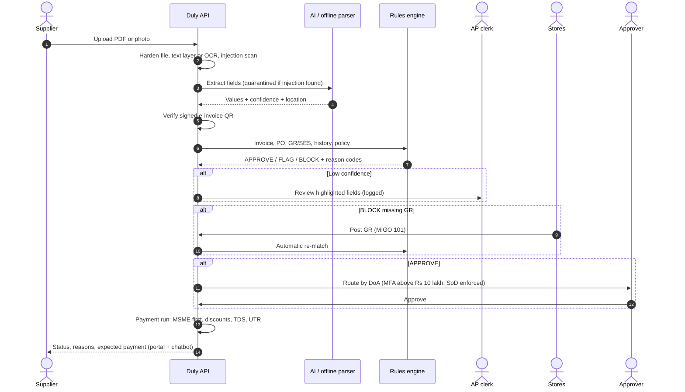
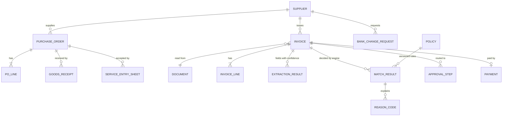

# Architecture

This file is rendered as-is on the in-app **Architecture** page (`/architecture`), so the diagram we present is
the one in the app. Module names below are the real packages under `backend/app/`.

## Components

Duly is a side-car to the ERP: a React single-page app, a FastAPI backend with a deterministic rules engine at its
centre, and SQLite (Postgres-ready). Invoices are read by local OCR and rules (our setup runs in AI mode offline);
an optional AI integration can read documents and answer supplier questions, but it never decides.

- **AI never decides.** `engine` imports nothing from `ai` (a test enforces it). AI output is only a set of
  extracted values with confidence; low confidence goes to a human.
- **Untrusted input first.** Uploads are hardened (type, size, page count, active PDF content) and scanned for
  hidden instructions before any AI sees them.
- **Everything is audited.** Every match, approval, payment, review and refusal is a hash-chained event; the head
  is signed (Ed25519).

## Invoice lifecycle

## Data model (core)

Audit events are a separate append-only table, linked to entities by type and id, so no business table can
rewrite history.

## Scaling path

- Stateless API: run more workers behind a load balancer; sessions are signed cookies.
- `DATABASE_URL` switches SQLite to Postgres; indexes on supplier, status, due dates and invoice numbers.
- Policies (tolerances, DoA, TDS, thresholds) are versioned data: finance changes rules without a release.
- The ERP adapter keeps SAP S/4HANA as the system of record (OData supplier-invoice post built by the stub).
- Production path: SSO via the company identity provider, the real IRP public key, BTP integration, pen test, DPIA.
